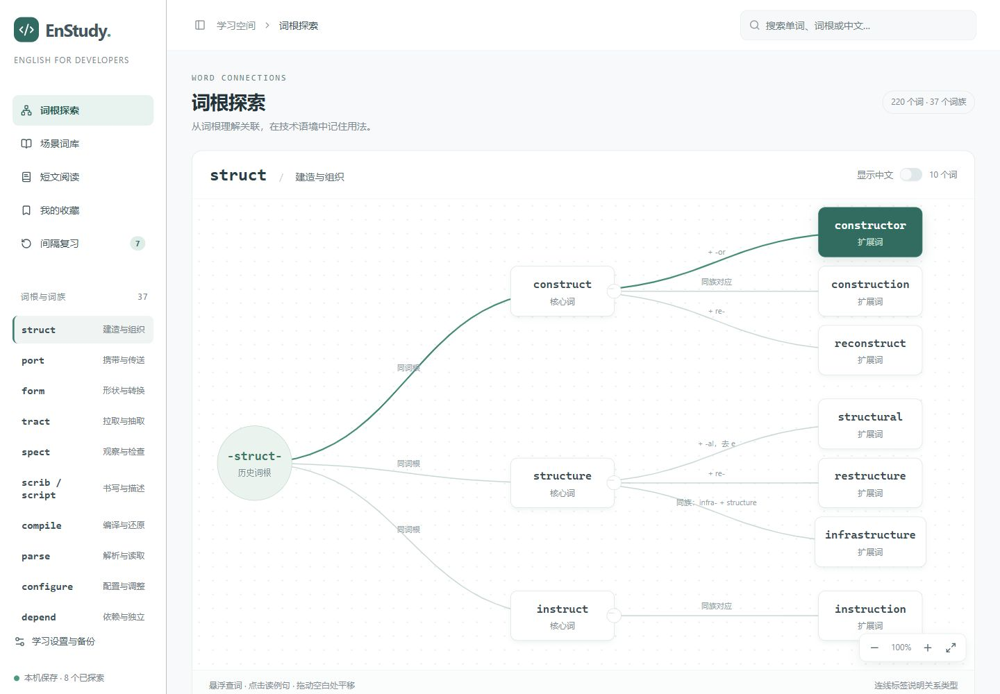
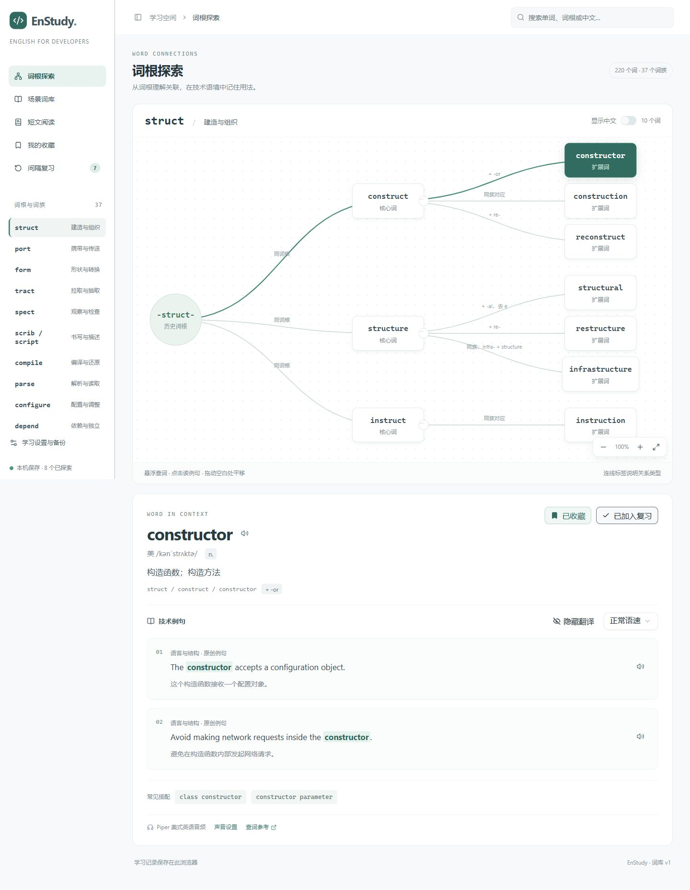
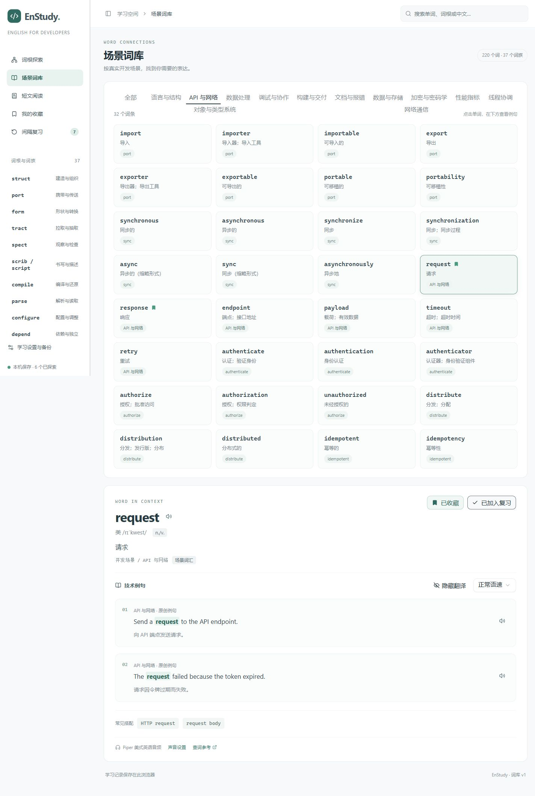
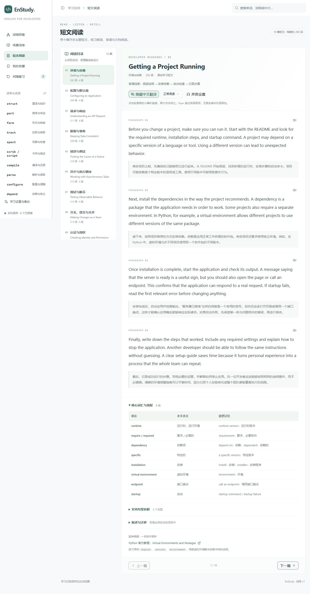
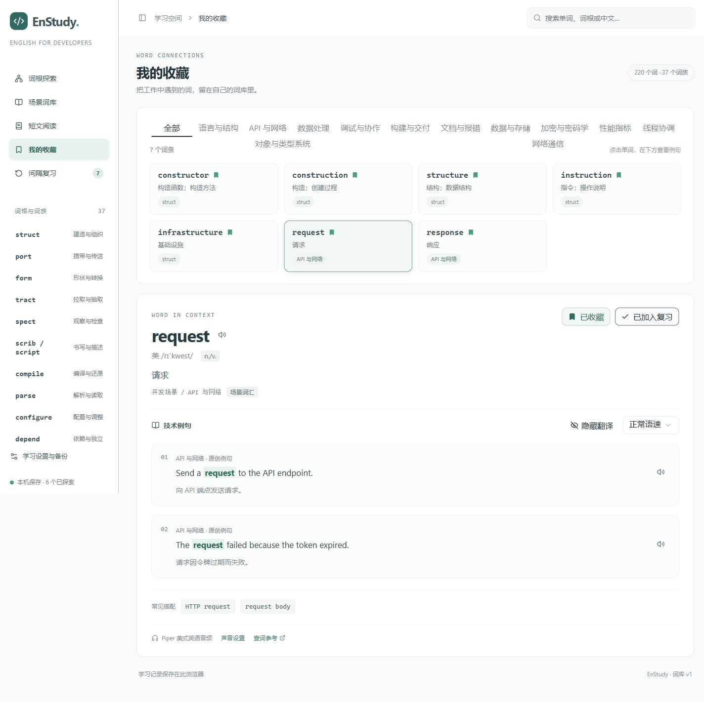
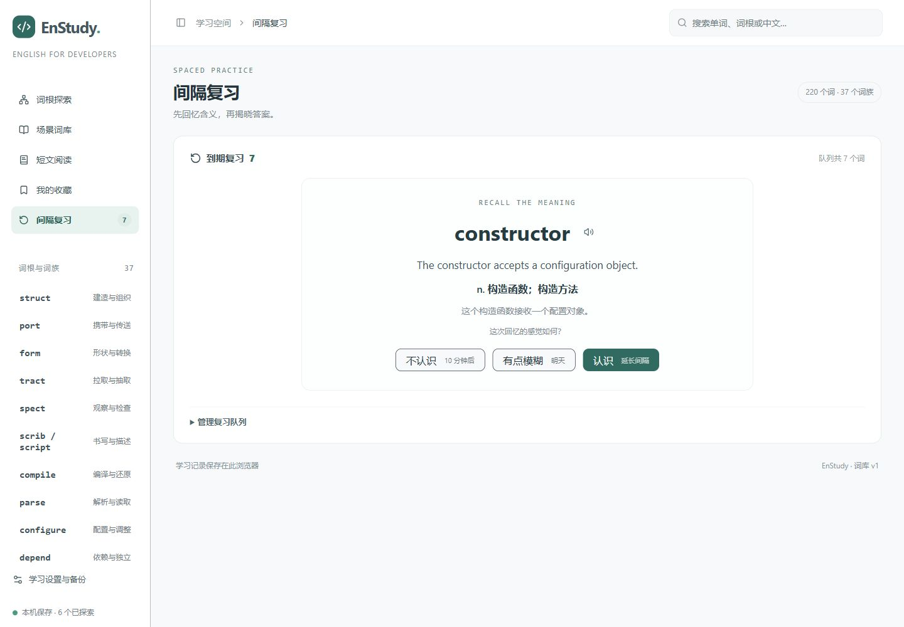
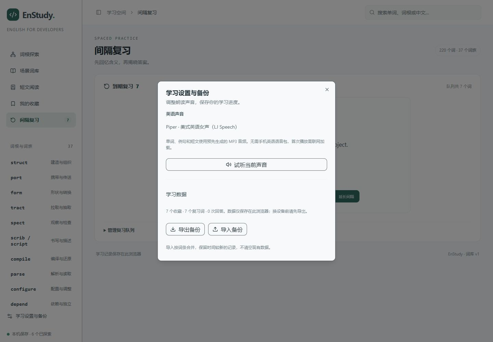
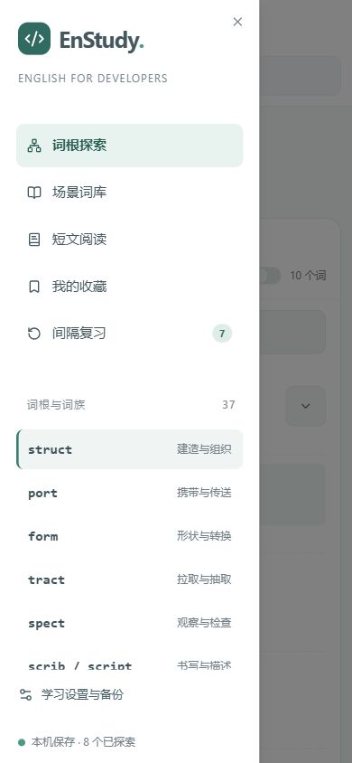
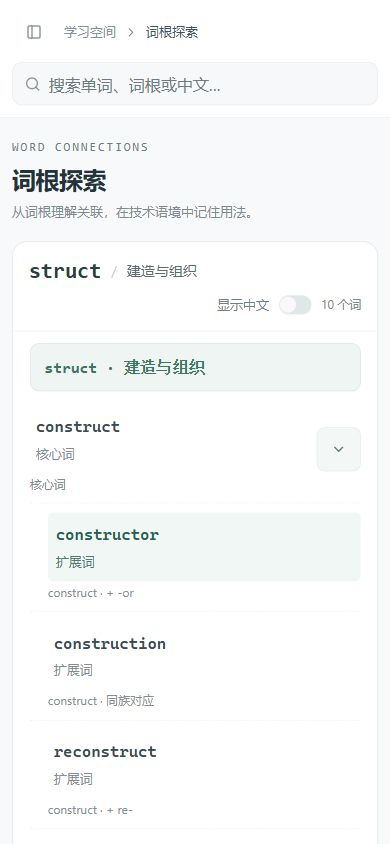
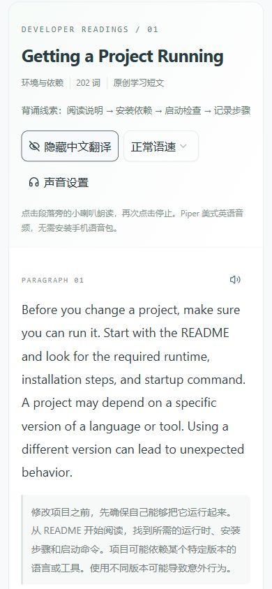

# EnStudy · 程序员英语学习

通过词根与词族图谱、技术例句和双语短文，学习软件开发中常见的英语表达。
界面面向中文开发者，支持桌面和手机浏览器。

[](https://github.com/yuehua-meng/EnStudy/actions/workflows/verify.yml)
[](LICENSE)


[](docs/screenshots/01-word-graph.jpg)

## 功能

- **词汇图谱**：从词基、核心词扩展到相关词，悬浮查看音标与释义，点击查看技术例句。
- **词库与复习**：220 个词条、440 条技术例句，支持搜索、收藏、掌握度与复习。
- **短文阅读**：10 篇原创软件开发学习短文，提供中英对照、词汇搭配、句型与复述练习。
- **英语朗读**：700 个 Piper 预生成 MP3，覆盖单词、例句和短文段落，支持正常与慢速播放。
- **本地学习记录**：使用浏览器 IndexedDB，支持备份导出与导入。
- **手机适配**：抽屉导航、纵向词树、触摸按钮和可滚动设置面板。

词库同时包含词源关系、现代词族关系和技术关联，关系标签用于区分这些含义。
短文是围绕常见开发主题编写的学习材料，相关官方文档以链接形式提供。

## 界面预览

下面是项目实际运行时的截图，收藏与复习使用本地演示词条。点击展开查看完整页面。

<details>
<summary><strong>01 · 词根探索：把单词放回词族中学习</strong></summary>

从历史词根展开核心词和扩展词，查看派生关系、音标、释义与技术例句。



</details>

<details>
<summary><strong>02 · 场景词库：按软件开发场景查词</strong></summary>

按 API 与网络、数据处理、构建与交付等主题筛选，点击词条查看例句与翻译。



</details>

<details>
<summary><strong>03 · 短文阅读：读懂、朗读，再复述</strong></summary>

十篇开发主题文章，提供段落朗读、中英对照、核心搭配、句型拆解与复述练习。



</details>

<details>
<summary><strong>04 · 我的收藏：积累工作中常遇到的表达</strong></summary>

集中查看收藏的词条，保留技术例句和朗读入口，也可按场景筛选。



</details>

<details>
<summary><strong>05 · 间隔复习：先回忆，再揭晓答案</strong></summary>

根据回忆情况选择“不认识”“有点模糊”或“认识”，安排后续复习。



</details>

<details>
<summary><strong>06 · 学习设置与备份：试听英语声音、保存进度</strong></summary>

查看 Piper 音频方案，试听声音，导出学习记录或合并导入已有备份。



</details>

### 手机浏览器

手机端提供抽屉导航、纵向词树和适合窄屏的双语阅读。下面按 390 × 844 的视口展示。

<table>
  <tr>
    <th>学习导航</th>
    <th>词根探索</th>
    <th>双语短文</th>
  </tr>
  <tr>
    <td></td>
    <td></td>
    <td></td>
  </tr>
</table>

## 快速开始

需要 Node.js **22.13 或更新版本**，推荐 Node.js 24。预生成音频已包含在仓库中。

```sh
cd web
npm ci
npm run dev:static
```

打开 `http://127.0.0.1:5174/`。无需配置数据库、API Key 或云账号。

构建并预览：

```sh
npm run build:static
npm run preview:static
```

将 `web/dist-static/` 发布到静态服务器即可，支持站点根路径或 `/enstudy/` 子路径。
通用 Docker/Caddy 部署和 Piper 音频更新步骤见 [部署说明](deploy/README.md)。

仓库还保留原有 Vinext 开发入口（`npm run dev`，默认端口 5173）。
独立部署建议使用上面的静态入口，浏览器端学习功能无需服务器数据库。

## 项目结构

```text
web/components/           词汇图谱、短文阅读与学习界面
web/lib/                  词库、短文、学习记录和音频播放
web/public/audio/         预生成的英语音频
web/deploy/               静态网页入口
web/scripts/              内容同步与音频清单生成
docs/                     产品设计与十篇双语学习文章
vocabulary-supplements/   可独立导入的补充词库
deploy/                   通用部署工具与 Piper 生成脚本
scripts/                  公开文件敏感信息检查
```

## 编辑内容

词汇数据位于 `web/lib/vocabulary.ts`。阅读材料以
[双语学习文章](docs/程序员英语精读与背诵-10篇核心文章.md) 为源文件，修改后执行：

```sh
cd web
node scripts/sync-reading-articles.mjs
npm run audio:prepare
```

然后按部署说明重新生成音频，将 MP3 复制到 `web/public/audio/`，再构建。
新增文本未生成音频时无法朗读，清单与 MP3 必须一起更新。

学习记录保存在当前浏览器和访问地址下，不会自动跨设备同步。
更换访问域名、从 HTTP 切换到 HTTPS 或更换浏览器前，请导出备份。

## 验证与贡献

```sh
cd web
npx tsc --noEmit
npm run build:static
cd ..
python scripts/check-public-files.py
```

公开文件检查只报告文件名、行号和问题类型，不输出疑似凭据。
贡献指南见 [CONTRIBUTING.md](CONTRIBUTING.md)。

## 许可证

本项目原创源码和学习内容采用 [MIT License](LICENSE)。
第三方组件、语音引擎及模型遵循各自许可证，详见
[THIRD_PARTY_NOTICES.md](THIRD_PARTY_NOTICES.md)。Piper 引擎和模型权重不随仓库分发。
