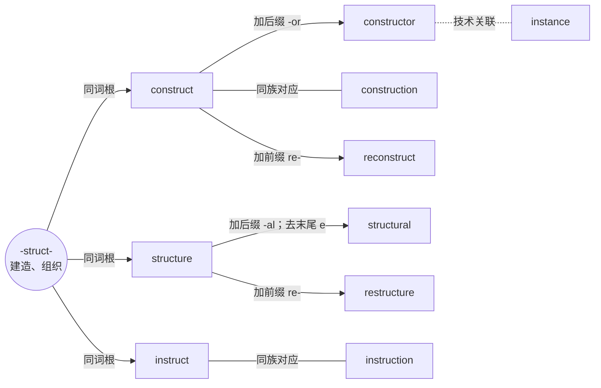

# EnStudy：程序员英语词汇图谱

**功能与设计文档 v0.1 · 2026-10-03 · 待确认（已补充单词与例句朗读方案）**

> 用词根理解一组词，用技术语境记住一个词。当前交付是产品方案和交互评审示意，尚未进入正式网站开发。

## 1. 产品目标与默认假设

面向已经懂编程、希望更顺畅地阅读英文文档、错误信息、代码注释和技术讨论的中文开发者。第一版优先解决“经常遇到，但只认识大概意思、不会举一反三”的问题。

核心体验：**选择词根或词族 → 看核心词 → 展开关联词 → 悬浮查音标和释义 → 点击读技术例句 → 主动回忆与复习。**

默认按以下方向设计，均可在本轮评审时调整：

- 桌面浏览器优先，移动端提供列表和点击学习模式。
- 中文界面，英文词汇；美式音标优先，后续可补英式。
- 第一版覆盖通用开发语境，示例兼顾 API、数据处理、构建、测试和协作，不绑定某门语言。
- 无需登录即可使用；学习记录保存在当前浏览器，提供导出和恢复。
- 首期目标为 120–160 个去重词条、约 12 个重点词族、至少 240 条原创双语例句。这是内容建设目标，本文候选词表不是已审核完成的词库。

不把“打开过词条”视为掌握，也不把所有单词强行拆成词根。

## 2. 内容组织：词根、词基、词族、场景

### 2.1 三层展示，多种关系

用户看到的是“词根／词基 → 核心词 → 扩展词”的学习层级，但数据底层允许一个词属于多个词族和场景。

| 类型 | 含义 | 示例 | 展示规则 |
| --- | --- | --- | --- |
| 历史词根 | 有词源依据的共同构词来源 | `-struct-`：建造、组织 | 圆形；带“词根”标签 |
| 现代词基 | 今天可用于理解派生的完整单词 | `parse`、`type` | 圆角方框；带“词基”标签 |
| 核心词 | 在当前学习路径中优先掌握的词 | `construct`、`structure` | 较大的圆角方框 |
| 扩展词 | 派生、屈折或同族词，需要明确关系类型 | `constructor`、`structural` | 普通圆角方框 |
| 场景 | 跨词族的实际开发主题 | API、调试、代码评审 | 分类入口，不伪装成词根 |

“核心词”是学习优先级，不是永久的语言学分类。同一个词在另一条路径中可以成为入口。

### 2.2 连线必须说明是什么关系

| 连线关系 | 例子 | 视觉与交互 |
| --- | --- | --- |
| 词源归属 | `-struct- → construct` | 实线，标“同词根”；箭头表示学习展开方向 |
| 现代构词 | `construct → constructor` | 实线箭头，标 `+ -or`；必要时说明拼写变化 |
| 同族对应 | `construct ↔ construction` | 标“同族／词性对应”，不自动声称后者由前者历史派生 |
| 屈折变化 | `configure → configured` | 单独标“过去式／过去分词”；默认收进词条，不铺满图 |
| 技术关联 | `constructor ↔ instance` | 虚线，无因果方向；默认隐藏，主动开启后展示 |
| 对比关系 | `mutable ↔ immutable` | 明确标“反义”；有构词关系时在详情同时解释 |

现代构词分析和历史借入顺序是两回事。例如 `construction` 与 `construct` 适合放在一起学习，但不应仅凭词形就写成“英语中先有 construct，再加后缀产生 construction”。没有证据的拆分仅可标为“记忆提示”，不能进入正式词源边。

### 2.3 完整示例：struct 词族



`construct`、`structure`、`instruct` 的词源都能追溯至拉丁语中“建造／组织”相关形式。这一层共同来源可作为学习支架，但现代技术含义仍需逐词解释。[construct 词源](https://www.etymonline.com/word/construct)、[structure 词源](https://www.etymonline.com/word/structure)、[instruct 词源](https://www.etymonline.com/word/instruct)。

默认只显示一个词族的 8–15 个节点。展开更多分支时，单屏暂定上限 25 个；超过上限给出“收起其他分支”或“单独查看此词族”。图谱不会自动不断漂动。

## 3. 首批候选词库

下面是选词与组织提案。历史词源、每条构词关系、音标和义项在正式入库前需要逐条审核；“常用”目前表示编辑按开发场景推荐，尚未进行语料统计，不展示虚构词频或覆盖率。

### 3.1 以历史词根为入口的候选词族

| 入口与记忆含义 | 优先核心词 | 扩展候选与技术含义 |
| --- | --- | --- |
| `struct`：建造、组织 | construct 构造；structure 结构；instruct 指示 | constructor 构造函数；construction 构造；structural 结构的；restructure 调整结构；reconstruct 重建；instruction 指令 |
| `port`：携带、传送 | import 导入；export 导出；transport 传输 | importer 导入工具；exporter 导出工具；portable 可移植的；portability 可移植性；transportation 运输（延伸词，低优先级） |
| `form`：形状、形成 | form 形成／表单；transform 转换 | transformation 转换；transformer 转换器；reform 改革（延伸词）；formal 形式的；formally 形式上（须区分现代技术义） |
| `tract`：拉、引 | extract 提取；abstract 抽象 | extraction 提取；extractor 提取器；abstraction 抽象；abstractly 抽象地；distract 分散注意力（延伸词） |
| `spect`：看、观察 | inspect 检查；introspect 自省 | inspection 检查；inspector 检查工具；introspection 自省／内省；retrospect 回顾；retrospective 复盘（会议） |
| `scrib / script`：写 | script 脚本；describe 描述；subscribe 订阅 | scripting 脚本编写；description 描述；descriptive 描述性的；subscriber 订阅者；subscription 订阅 |

表中同一行并不意味着所有扩展词都直接由该行第一个核心词派生。实际连线须按来源建边；`port` 的“网络端口”和“移植”需要分义，不能直接把所有 port 义项挂在同一条解释下面。

### 3.2 以现代词基为入口的实用词族

| 词基 | 核心意义 | 扩展候选 |
| --- | --- | --- |
| compile | 编译 | compiler 编译器；compilation 编译；recompile 重新编译；compiled 已编译的 |
| parse | 解析 | parser 解析器；parsing 解析过程；parsed 已解析的；unparsed 未解析的 |
| configure | 配置 | configuration 配置；configurable 可配置的；reconfigure 重新配置；misconfiguration 配置错误 |
| depend | 依赖 | dependency 依赖项；dependent 依赖的；independent 独立的；independence 独立性 |
| mutate | 改变 | mutation 变更；mutable 可变的；immutable 不可变的；immutability 不可变性（按同族与构词分别建边） |
| sync / synchronous | 同步 | synchronize 同步；synchronization 同步；asynchronous 异步的；asynchronously 异步地；async、sync 标为缩略形式 |

不把过去式、复数机械计入“已学新词”。只有有独立学习价值的形式才单列，例如 `compiled` 的形容词用法。

### 3.3 场景补充词

词根不能覆盖所有重要词。以下词汇通过场景入口纳入同一词库，有可验证构词关系时再连到词族。

| 场景 | 建议补充 |
| --- | --- |
| 文档与报错 | argument 参数／实参；parameter 参数／形参；exception 异常；invalid 无效的；deprecated 不推荐使用的；undefined 未定义的 |
| API 与网络 | request 请求；response 响应；endpoint 端点；payload 载荷；timeout 超时；retry 重试 |
| 构建与交付 | build 构建；deploy 部署；release 发布／版本；artifact 构建产物；environment 环境；rollback 回滚 |
| 数据与存储 | query 查询；schema 模式；transaction 事务；cache 缓存；index 索引；constraint 约束 |
| 调试与协作 | debug 调试；trace 跟踪；assert 断言；mock 模拟；merge 合并；conflict 冲突；review 评审；approve 批准 |

上述中文为开发语境中的简释，不代表词条的全部义项；如 `argument` 的“实参”释义需明确语言／文档语境。

## 4. 页面与信息架构

### 4.1 桌面主学习页

```text
┌──────────────────────────────────────────────────────────────┐
│ EnStudy   词根图谱 / 场景词库 / 我的复习     搜索词、词根、中文 │
├──────────────┬───────────────────────────────────────────────┤
│ 词根 / 词族   │ 当前词族：struct · 建造、组织                  │
│ ● struct     │ [同族] [技术关联：关]   [适应视图]             │
│ ○ port       │                                               │
│ ○ compile    │ (词根) ── [核心词] ── [派生词]                │
│              │          悬浮 → 音标＋词性＋开发义              │
│ 场景         │          点击 → 固定选中并更新下方内容          │
│ API / 调试…  │                                               │
├──────────────┴───────────────────────────────────────────────┤
│ constructor  美 /kənˈstrʌk.tɚ/  n. 构造函数   [发音] [收藏]  │
│ 关系路径：struct → construct → constructor                    │
│ 技术例句  ·  中文翻译  ·  常见搭配  ·  构词解释                │
│ [加入复习]                                                   │
└──────────────────────────────────────────────────────────────┘
```

初始比例建议：左侧目录约 220 px；上方图谱占可用内容高度约 60%，下方词条区约 40%。这些是设计基准，不是固定像素锁定；较矮屏幕使用自然页面滚动，确保例句不会被挤没。

首屏默认打开推荐词族并选中一个核心词，下方立即有内容。图谱中的当前词、详情标题和关系路径始终对应。

### 4.2 视觉方向

- 推荐“安静的开发工具”风格：浅色画布、清晰文字、轻边框；保留暗色模式作为后续增强。
- 词根用圆形，核心词和扩展词用圆角方框；大小、文字标签和连线共同说明角色。
- 默认采用从左到右的稳定层级图，阅读顺序明确；环状发散作为可评审的备选布局。
- 默认节点只放英文词与角色／简短状态；中文含义通过悬浮和下方详情出现。可选“节点显示中文”。
- 选中词高亮，相关路径强调，其他分支保持可读；点击不触发全图重新洗牌。
- 收藏状态、掌握程度与选中状态采用不同标记，不能仅靠颜色区分。

### 4.3 移动端

小于约 768 px 时将目录改为词族选择器，主区默认为可展开的关系树列表；保留小图预览作为辅助。点击词条直接更新下方详情，音标和释义常驻详情，无需悬浮。树节点以缩进和关系标签保留关联信息，不把桌面大图简单缩小。

## 5. 核心交互规范

| 操作 | 预期行为 | 细节 |
| --- | --- | --- |
| 悬浮单词 | 约 200 ms 后显示浮层 | 单词、词性、所选口音音标、1–2 条开发释义；不放长例句 |
| 移入浮层 | 浮层继续可见 | 可选择文本；离开触发点及浮层约 150 ms 后关闭；Esc 关闭 |
| 键盘聚焦单词 | 提供同等简释 | Enter／Space 选词；Tab 可遍历节点；不把说明只藏在鼠标交互里 |
| 单击单词 | 固定选中并更新底部详情 | 当前路径高亮；悬浮别的词不会覆盖已选词 |
| 点击词根 | 显示词根解释与核心词列表 | 词根不是完整单词时不生成伪造的读音或词根例句 |
| 点击展开标记 | 展开该分支 | 展开与选词使用分开的点击目标，避免误操作 |
| 拖动画布／缩放 | 移动图谱视图 | 拖动不误触词条；缩放以明确控件为基础；普通滚轮优先滚动页面 |
| 点击空白画布 | 关闭临时浮层 | 保留已选词和下方内容 |
| 搜索 | 搜索词形、词根、中文释义 | 精确匹配优先；结果显示词族和词性；选中后定位且展开目标路径 |
| 切换词族 | 加载相应局部图谱 | 选中该词族默认核心词，详情同步；浏览器返回恢复上一状态 |
| 收藏 | 加入／移出收藏 | 收藏不自动改变掌握程度，也不自动产生复习成绩 |
| 单词朗读 | 点击详情标题旁的小喇叭，朗读该单词 | 使用当前词性与口音对应的内容；不朗读 IPA、词性标签和中文释义 |
| 例句朗读 | 点击每条英文例句旁的小喇叭，朗读该句 | 只朗读这条英文，不连续朗读其他例句或中文翻译；隐藏翻译时仍可播放 |
| 播放控制 | 当前正在播放的喇叭变为停止按钮 | 再点停止；点击另一项先停止上一项；切换所选词条或离开学习页时停止 |

浮层必须避开窗口边缘，不能覆盖正在查看的词。缺失音标时显示“音标待补充”；缺失例句时显示状态，不用占位英文伪装真实内容。加载失败提供重试；搜索无结果允许回到场景词库。

## 6. 单词详情与技术例句

每个正式词条包含：词形、词性、音标及口音、普通含义、开发义项、构词说明、相关词、常见搭配、至少两条原创双语例句、来源和审核状态。普通含义折叠，技术义优先。

例句按场景标记，例如“API 文档”“报错说明”“代码评审”。默认同时展示英文和译文；提供“隐藏翻译”用于主动理解。例句中的目标词突出显示，但不把代码标识符一律当作自然语言单词。

### 样例词条：constructor

- **美式 IPA：** `/kənˈstrʌk.tɚ/`；**词性：** n.
- **开发释义：** 构造函数／构造方法，具体称呼取决于语言。
- **现代构词提示：** `construct + -or`；后缀常用于表示执行某种行为的人或事物，此处需结合编程义理解。
- **常见搭配：** class constructor、default constructor、constructor parameter。
- **易混说明：** constructor 指构造机制，instance 指实例；二者是技术概念关联。

**原创例句 1 · API 文档**

> The constructor accepts a configuration object.
>
> 这个构造函数接收一个配置对象。

**原创例句 2 · 代码评审**

> Avoid making network requests inside the constructor.
>
> 避免在构造函数内部发起网络请求。

**短代码辅助理解（后续增强，可折叠）：**

```javascript
class ApiClient {
  constructor(config) {
    this.baseUrl = config.baseUrl;
  }
}
```

发音校对参考 [Cambridge constructor](https://dictionary.cambridge.org/pronunciation/english/constructor)。上述技术例句是为本产品原创的教学内容，不冒充词典或文档原句。JavaScript 技术义及代码语境参考 [MDN constructor](https://developer.mozilla.org/en-US/docs/Web/JavaScript/Reference/Classes/constructor)。

### 其他例句方向

| 单词 | 原创技术例句 | 中文翻译 |
| --- | --- | --- |
| dependency | This package has no external dependencies. | 这个包没有外部依赖。 |
| immutable | Return a new object instead of modifying the immutable value. | 返回一个新对象，而不要修改这个不可变值。 |
| parse | Parse the JSON response before accessing its properties. | 先解析 JSON 响应，再访问其中的属性。 |
| deprecated | This method is deprecated; use the new API instead. | 此方法已不推荐使用；请改用新 API。 |
| transaction | Roll back the transaction if any operation fails. | 如果任何操作失败，就回滚该事务。 |

正式词条应按义项匹配例句。例如 `instruction` 的“操作说明”和“处理器指令”分别展示，不能让一个中文释义覆盖所有语境。

### 6.1 新增：单词与例句的小喇叭

**本节是实现方案，尚未修改交互示意或接入实际朗读。**

#### 页面位置

```text
constructor  [🔊 朗读单词]                 语速：正常 / 慢速
美 /kənˈstrʌk.tɚ/    n. 构造函数

The constructor accepts a configuration object.  [🔊 朗读例句]
这个构造函数接收一个配置对象。

Avoid making network requests inside the constructor.  [🔊 朗读例句]
避免在构造函数内部发起网络请求。
```

实际界面使用统一的喇叭图标，示意中的文字用作悬浮提示和无障碍标签。按钮紧跟标题或例句，不为每句增加一整条播放器。移动端图标外保留约 44×44 px 的可点击区域，长句换行后按钮仍可见。

#### 播放行为

- 默认点击后朗读一次；单词、句子分别触发。不因进入页面、悬浮、选词或隐藏翻译而自动发声。
- 任何时刻只保留一个播放任务。点击另一条时停止旧任务并立即尝试新任务，不把多次点击排成长队。
- 当前喇叭在准备期间显示加载状态，开始发声后显示停止图标；读完恢复喇叭。准备中和播放中再次点击都可以取消。
- 首期提供“正常／慢速”，默认正常并记住选择。系统合成可从 rate=1 和 rate=0.8 开始调试；这是相对请求参数，不保证各个音色的实际语速相同。
- 切换词条、离开学习页、页面隐藏时终止当前朗读；悬浮其他词不打断当前朗读。切换语速则停止，下一次点击使用新设置。
- 词根片段（如 `-struct-`）不显示单词发音按钮；完整的现代词基可以朗读。
- 无英文声音、播放被阻止或加载失败时，恢复可操作状态并显示具体提示；用户可重试。界面不无限显示“正在播放”。

#### 三种技术路线

| 路线 | 实现方式 | 适用阶段 | 主要取舍 |
| --- | --- | --- | --- |
| 浏览器／系统语音 | `speechSynthesis` 直接合成单词或句子 | 推荐用于体验版 | 前端即可接入，无需自建语音后端；可选音色依赖设备和浏览器，需运行时检查 |
| 预生成音频 | 为固定词库提前生成／录制并校对音频，以音频文件播放 | 推荐用于正式词库 | 同一素材可在各设备播放，便于试听审校；有制作、存储和分发成本 |
| 实时云端 TTS | 点击时通过后端请求语音服务，并缓存结果 | 后续用户自定义句子 | 适合动态内容；增加网络等待、接口费用和后端维护 |

**推荐顺序：体验版采用浏览器语音；正式词库逐步接入经校对的预生成音频。** 上线时可优先播放已配置音频，缺失时明确标为“系统朗读”。某次音频加载失败时提供“重试／使用系统朗读”，不悄悄切换音色。

浏览器的 `getVoices()` 返回当前设备可用的声音；应先取一次，并监听 `voiceschanged` 更新。不能仅设置 `lang="en-US"` 就承诺一定存在美式音色。[MDN getVoices](https://developer.mozilla.org/en-US/docs/Web/API/SpeechSynthesis/getVoices)。

系统声音也可能由远程服务提供。可以通过 `localService` 区分本地与远程类型，因此不承诺所有设备都离线可用，也不笼统承诺所有系统声音完全没有网络或服务成本。[MDN localService](https://developer.mozilla.org/en-US/docs/Web/API/SpeechSynthesisVoice/localService)。

#### 发音质量与范围

- 优先尝试当前设备的美式英语声音；若只有其他英语口音，标明实际口音并让用户选择。未找到英语声音时提示不可用，不默默采用中文音色。
- IPA 是经校对的词条数据，不能作为文本直接送进朗读器，也不能据此假定合成器会读出对应重音。`construct`、`export` 这类词的不同词性读音需重点试听，正式内容可按词性／读音分别绑定音频。
- 例句保留展示文本 `en`，必要时另设经过审核的 `spokenText`，处理 `API`、标识符或符号的读法；不能用全局替换随意改写技术术语。
- 第一版按整句播放和高亮，不承诺逐词跟读高亮。中文朗读、循环播放、录音跟读评分及更多口音属于后续增强；本功能不需要麦克风权限。

## 7. 建议增加的学习功能

### 首期：让浏览形成学习闭环

1. **收藏与待复习队列：** 学习时手动加入，允许移出。收藏和复习互相独立。
2. **简单自评复习：** 展示英文技术句并隐藏译文；用户先回忆，再揭晓，选择“不认识／模糊／认识”。
3. **学习路径记录：** 保存最近词族、最近单词和已探索词；下次继续。
4. **开发搭配：** 词条附 2–3 个常见短语，例如 resolve a dependency、handle an exception。
5. **数据导出与恢复：** 导出带版本号的 JSON，恢复前显示条目数和合并说明；按词条 ID 合并，保留较新的记录。

初版复习可用明确的启发式间隔：首次“认识”约 1 天后，下次约 3 天，再次约 7 天；“模糊”回到 1 天；“不认识”本轮稍后再见。按真实回答记录到期时间，不因点击浏览自动推进。它是便于实现的起始规则，不声称是个体最优记忆算法。

### 后续按价值排序

| 优先级 | 功能 | 价值与边界 |
| --- | --- | --- |
| P1 | 近义／易混词对比 | argument / parameter、concurrent / parallel、deprecated / obsolete；说明适用语境 |
| P1 | 词根填空与场景选义 | 检验关系和实际理解；允许合理答案变体 |
| P1 | 生词笔记与个人例句 | 用户记录自己在工作中遇到的用法 |
| P1 | 更精细的复习调度 | 在积累回答历史后评估 FSRS 等方案，选型另行验证 |
| P2 | 粘贴技术文档提取生词 | 先匹配已有词库，识别驼峰／下划线名称；上传外部模型前说明数据去向 |
| P2 | 按技术栈定制 | 前端、后端、数据库、DevOps 等场景包 |
| P2 | 多设备同步、离线安装 | 在基础学习体验验证后增加账号和同步 |
| P2 | AI 补充例句与解释 | 必须标注生成来源；未审核内容不直接覆盖主词库 |

首期不加入排行榜、社交、付费体系和大规模自动抓词。优先判断“看完一个词族后，能否读懂下一条实际开发句子”。

## 8. MVP 范围与交付边界

| 模块 | P0 必须交付 | 后续增强 |
| --- | --- | --- |
| 内容 | 120–160 个审核词条；约 12 个词族；每词至少 2 句 | 更多场景包与难度分层 |
| 图谱 | 单词族层级布局、展开收起、选择、悬浮、缩放、适应视图 | 环状布局切换、跨族探索、小地图 |
| 详情 | IPA、开发义、双语例句、搭配、关系解释 | 短代码、多口音、个人笔记 |
| 朗读 | 单词和每条例句的小喇叭、互斥播放、停止、正常／慢速、错误提示 | 校对后的预生成音频、更多口音、循环与跟读 |
| 查找 | 英文／中文／词根搜索、场景入口 | 模糊拼写纠错、文档自动提词 |
| 学习 | 收藏、加入复习、自评、学习位置恢复 | 多题型、自适应计划 |
| 兼容 | 桌面图谱、移动关系树、键盘操作 | 完整移动图谱操作 |
| 数据 | 本地保存、JSON 导出恢复、数据格式版本 | 账号、云同步、在线词库编辑 |

朗读实现采用第 6.1 节的分阶段方案：首版优先使用系统合成语音，并为预生成音频保留接口。音标来自独立校对的数据，不从合成语音反推；实际声音与口音需运行时检测。[SpeechSynthesis 接口说明](https://developer.mozilla.org/en-US/docs/Web/API/SpeechSynthesis)。

本轮交互评审示意只演示一个词族的两种布局、悬浮和点击联动；收藏、复习、搜索、真实发音及完整词库仍属于后续开发范围。

## 9. 技术设计建议

### 9.1 架构

建议采用 **React + TypeScript + Vite** 的静态前端作为 MVP 起点，词库随版本发布，个人数据保存在浏览器 IndexedDB；少量界面偏好可放 localStorage。无需为了第一版先建设账号、服务端和数据库服务。

图谱候选使用 React Flow，配合层级布局工具；移动端基于同一数据渲染语义化树列表。React Flow 的节点、边和视图能力与本项目相符，但中文浮层、关系语义和自动布局仍需应用自己设计。[React Flow 官方文档](https://reactflow.dev/learn)。选型是当前建议，具体版本及依赖兼容性在开发开始时锁定。

图数据库不是首期必需：节点和边用结构化数据足够表达。需要账号和内容后台时，再增加 API 与关系数据库；图谱数据结构与用户学习记录保持分离。

### 9.2 数据模型

| 实体 | 关键字段 | 说明 |
| --- | --- | --- |
| Root / Base | id、label、kind、meaningZh、variants、sourceRefs | kind 区分历史词根和现代词基 |
| Lexeme | id、lemma、forms、senseIds、pronunciations、familyIds、topicIds、priority | 一个词形可以有多个词性／义项及多个词族 |
| Sense | id、lexemeId、partOfSpeech、domain、meaningZh、usageNote | 普通义、技术义分开；可绑定特定读音 |
| Pronunciation | locale、ipa、partOfSpeech、sourceRef、audioRef? | 支持名词／动词不同重音；音频单独记录来源 |
| Relation | id、fromId、toId、type、label、explanation、sourceRefs、reviewStatus | relation 类型控制连线；来源和审核状态必填 |
| Example | id、senseId、en、zh、topic、targetSpans、origin、sourceRef?、reviewStatus | targetSpans 用字符范围高亮；origin 区分原创／引用 |
| LearningState | lexemeId、senseId?、starred、inReview、familiarity、dueAt、updatedAt | 初版按词复习，允许后续细化到义项 |
| ReviewEvent | id、lexemeId、rating、answeredAt、previousDueAt、nextDueAt | 保留回答历史，便于未来迁移调度算法 |
| ContentRelease | schemaVersion、contentVersion、releasedAt | 导入、更新和数据迁移的依据 |

词条 ID 稳定，不使用节点坐标或当前显示名称作为主键。不同词性读音不同的词（例如 construct、export）必须能够分别展示。技术关联可以跨词族，不能要求全图是一棵树；只对当前词族投影生成阅读布局。

### 9.3 图谱与状态

- 将“悬浮节点”“选中词条”“展开分支”“当前视图位置”分开管理。
- 切换 hover 只改变浮层；切换 selection 才改变详情。
- 为布局计算提供稳定排序和坐标缓存，减少展开时跳动。
- 大词族按需展开；不一次性把全部词库渲染到画布。
- 搜索结果路由至少支持词条 ID，使收藏／分享链接可直达并定位。
- 本地存储失败时显示状态并允许导出；浏览器数据被清理后无法自动恢复，首期界面应明确“保存在此浏览器”。

### 9.4 朗读模块的实现分工

建立一个页面共享的 `SpeechController`，由所有单词和例句按钮调用；不要让每个按钮各自维护独立的朗读队列。

```text
按钮传入 contentId、kind、text / spokenText、locale、音频引用
  → 同一项再次点击：停止
  → 新的项：取消旧任务并分配新的 requestId
  → 有匹配的已审核音频：HTMLAudioElement 播放
  → 否则：选择英语 voice → 创建 SpeechSynthesisUtterance → speak()
  → start / end / error 更新按钮状态
```

首期实现系统语音分支即可；预生成音频分支只保留数据与接口设计。`SpeechSynthesisUtterance` 提供文本、语言、声音、语速和开始／结束／错误事件。[MDN Utterance](https://developer.mozilla.org/en-US/docs/Web/API/SpeechSynthesisUtterance)。

控制器需要处理：

1. **声音初始化：** 检测 API，获取声音并监听声音列表变化；列表尚未就绪时提示准备状态，设置有限等待和重试。用户声音偏好用稳定标识加语言保存，不保存跨设备不稳定的数组下标。
2. **互斥与取消：** 开始新任务前清理旧合成队列，并停止旧音频。事件回调核对 requestId，防止旧任务的结束／错误回调覆盖新任务状态。主动取消不显示为故障。
3. **实际播放状态：** `speak()` 被调用不等于已经发声，使用开始事件更新状态；启动超时允许取消重试。将当前 utterance 保留在控制器中，结束后清理。
4. **音频播放失败：** 后续音频分支处理 `audio.play()` 的 Promise 拒绝和媒体错误，不能只调用后就把按钮设为“播放中”。[MDN play](https://developer.mozilla.org/en-US/docs/Web/API/HTMLMediaElement/play)。
5. **生命周期：** 切词、卸载学习页或页面隐藏时停止并使旧 requestId 失效；恢复页面后不自行继续发声。

数据方面，`Example` 增加可选 `spokenText` 和 `audioRefs`；`Pronunciation.audioRef` 绑定具体词性与口音。后续 `AudioAsset` 记录 contentId、内容版本／文本哈希、locale、voice、URL、来源及审核状态，内容修改后不能继续复用旧句子的音频。生成密钥只保存在制作脚本或后端，不能放在前端代码中。

## 10. 内容建设与质量控制

1. 按文档、报错、API、协作等场景建立候选词清单，合并重复词形。
2. 优先收录日常开发会用到的义项，为低频延伸词设置较低学习优先级。
3. 查证词源与现代构词，分别建边；证据不足的关系不作为已确认词源发布。
4. 按统一口音规范校对 IPA，并检查词性变化导致的发音变化。
5. 每个词编写至少两条自然的技术句子，翻译对应具体义项，人工检查技术准确性。
6. 检查词条、关系、例句的来源与内容使用条件；参考链接不等于获得整库复制许可。优先原创释义和例句，不默认批量复制词典正文或音频。
7. 只有已审核内容进入默认学习模式；待审核内容留在编辑流程。

本次对 struct 示例的主要词源和 constructor 的技术用法做了参考核查；其余表格仍是候选清单。不能将本次方案视为已完成 120–160 词的内容审校。

## 11. 验收标准

### 功能验收

- 从词族进入核心词后，能沿有标签的边找到扩展词；词源、构词、屈折和技术关联不混用。
- 悬浮 constructor 能看到对应 IPA 和开发义；点击后底部展示对应两条例句及译文。
- 已选 constructor 时悬浮 structure，下方仍保留 constructor；点击 structure 后才切换。
- 搜索到折叠分支内的词，会展开正确路径并定位，不留下详情和图谱不一致的状态。
- 键盘可完成选词、查释义和收藏；触屏可在无 hover 的情况下完成同样的学习任务。
- 收藏、复习和最近位置刷新后保留；导出后可在干净浏览器恢复，未知词条 ID 有清晰处理结果。
- 自评回答推进或重置复习计划，普通浏览不修改回答历史；重复提交不会产生两条同一次回答。
- 单词喇叭只读该词，每条例句喇叭只读对应英文句子；译文隐藏与否不影响播放。播放中切换到另一项不会叠音，旧回调不会错误地重置新按钮。
- 连续点击、切换词条、页面隐藏、声音列表延迟、无英语音色和播放失败均有明确状态；正常／慢速可听辨，按钮可由键盘和触屏触发。桌面及移动设备需要实际试听，自动化事件测试不能代替发音质量检查。

### 内容与界面验收

- 每个正式词条有开发义、词性、可用 IPA 和至少两条审核例句；缺数据不会静默伪造。
- 每条词源边可以追溯来源；现代构词变化有说明；同族关系不被误标为历史派生。
- 在 1440×900、1024×768 和 390×844 视口中，节点、浮层和例句不重叠、不截断；窄屏列表可完成全流程。
- 以一套预先记录的目标设备与浏览器测量性能：首期 25 节点局部图，内容已载入时选词到详情更新目标小于 100 ms。该值是待验证目标，不是现有效果声明。

### 学习体验验证

用 3–5 位开发者进行首轮试用：能否在不解释界面的情况下找到派生词、分辨技术关联、读懂例句并完成一次复习。记录误连关系、术语不清和操作迷路的具体位置；少量试用数据不宣称证明长期学习效果。

## 12. 建议实施顺序

| 阶段 | 产出 | 进入下一阶段的条件 |
| --- | --- | --- |
| 当前：方案评审 | 本文＋两种图谱布局示意 | 确认布局、范围和学习目标 |
| 交互验证 | 一个词族、10–15 个词的完整学习页 | 悬浮、点击、触屏和键盘行为确认 |
| MVP 开发 | 图谱、详情、搜索、收藏、简单复习和本地数据 | 功能验收通过 |
| 内容扩充 | 120–160 词及至少 240 条例句 | 词源、IPA、技术义和例句审核完成 |
| 试用迭代 | 根据实际阅读与复习反馈修正 | 决定是否增加账号和更多场景包 |

工期需要在功能范围和内容审核方式确认后估算；内容审核很可能与界面开发同样重要。

## 13. 本轮希望确认的三件事

1. **布局：** 推荐“左到右层级图＋页面下方例句”；是否更喜欢环状发散？
2. **词库方向：** 默认通用程序员英语；是否优先偏向前端、后端、数据库或其他技术栈？
3. **首期范围：** 推荐图谱、例句、搜索、收藏和简单复习，暂时无需账号。是否按这一范围推进？

未提出调整时，这三项仅作为方案推荐，不代表已授权开始正式开发或发布。
